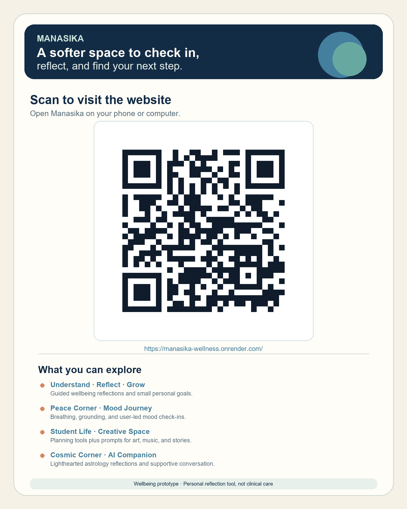

# Manasika

Manasika is a student wellness prototype built from the Figma-exported React app in `shivUIdes/manasika-ui`. Render serves this UI as a static site.

## URLs

- **Local development:** [http://localhost:4173](http://localhost:4173) after starting Vite with the command below.
- **Public site:** [https://manasika-wellness.onrender.com](https://manasika-wellness.onrender.com) — Render deployment verified live on 15 Nov 2026.

[](https://manasika-wellness.onrender.com)

## Requirements

- Node.js 22.14 or newer (`.node-version` pins 22.14.0)
- npm 10 or newer

## Install and run locally

From the repository root:

```powershell
cd "shivUIdes/manasika-ui"
npm ci
npm run dev -- --host 0.0.0.0 --port 4173
```

Open [http://localhost:4173](http://localhost:4173). Stop the development server with `Ctrl+C`.

To build and preview the production version:

```powershell
npm run build
npm run preview -- --host 0.0.0.0 --port 4173
```

## Build and deployment pipeline

1. `npm ci` installs the locked dependencies from `package-lock.json`.
2. `npm run build` generates the static site under `dist/`.
3. GitHub Actions runs the backend syntax check and Vite production build on every push or pull request to `main`.
4. Render publishes `dist/` from `shivUIdes/manasika-ui` and rebuilds the Docker API service.
5. The synced Render Blueprint tracks `main`; pushes to `main` trigger deployments.

After a deployment, run `npm run verify:deployment` from `shivUIdes/manasika-ui` to check the public site, deployed creative controls, backend health, and presence of the Cloudflare and Groq environment settings. This check does not generate images or text, so it does not consume provider quota.

### Automatic API wake-up

When someone opens the site, the browser now checks the API health endpoint and retries briefly while the Render Free service wakes from sleep. This is a lightweight health check: it does not create a session, call an AI provider, or consume generation quota. The first API action can still take longer if Render is cold-starting. Git pushes are handled by Render's GitHub auto-deploy pipeline; opening the site cannot safely trigger a new deployment for every visitor. Save API key changes in the Render service environment to apply them; secrets remain server-side.

Render keeps the Figma UI at [https://manasika-wellness.onrender.com](https://manasika-wellness.onrender.com) as a static site. A separate free Docker web service, `manasika-media-api`, serves the API. The frontend calls that service through `VITE_CREATIVE_MEDIA_API_URL`; the API allows requests only from the Manasika site origin. The free service has ephemeral storage: its SQLite database and generated image archive can be cleared when it sleeps, restarts, or redeploys.

## Date and time behavior

The interface reads the visitor’s device clock and local timezone. Date and time displays refresh every 30 seconds and when the tab regains focus. Mood check-ins use the visitor’s local calendar date. No GPS permission or external time service is required, so this works across locations without collecting location data.

## Cosmic Corner data

The provided zodiac prompt/response dataset is served from `shivUIdes/manasika-ui/public/data/western_zodiac_signs.json`. Cosmic Corner validates and loads its 500 records on first use, stores a versioned copy in the browser's `manasika-cosmic-corner` IndexedDB database, and retrieves a sign-matched response using the visitor's local date. Built-in reflections remain available if browser storage or the dataset request is unavailable.

The Figma UI is deployed as a static site and the companion/media API is a separate server. No language-model weights are bundled with the default deployment. The backend synchronizes versioned datasets into SQLite, then builds a reusable term index over support and literature records so Companion can search its stored knowledge directly. New dataset versions are picked up on backend startup. An optional local LoRA pipeline can train adapter weights and serve them separately; see the AI Companion training guide below. Browser IndexedDB data stays on the current browser/device and is not shared between users.

## AI Companion data

The base mental-health support file remains at `shivUIdes/manasika-ui/public/data/mental_health_support_chat.json`. The supplied augmented corpus is preserved as a gzip file under `public/data/datasets/ai_companion/`; the backend streams it into SQLite memory without loading the entire source into application memory. The database retains source records and marks only first-person mental-health support examples that pass relevance/safety filters as retrievable. Companion responses search this server memory first, then fall back to the browser's versioned `manasika-ai-companion-memory` IndexedDB if the backend is unavailable. Chat messages themselves are not stored. Urgent-risk messages and requests for diagnosis or medication guidance use fixed safety responses before retrieval. This is retrieval-based data modeling; it does not fine-tune model weights.

The 37-record `companion_wellbeing_topics.json` dataset adds curated, source-linked support for the requested emotion, relationship, decision, school/work, and clinical-concern topics. Backend startup syncs it into the versioned SQLite `ai_companion_curated_memory` table and retrieval index. Urgent-risk routing remains ahead of retrieval, and clinical records recommend professional assessment rather than diagnosing. This updates database-backed responses; it does not modify LoRA weights. To include eligible general/professional records in a future training run, re-prepare and train with the optional pipeline below.

The additional `training/datasets/ai_companion_training_mndataset.json` is a separate, normalized copy of the supplied CSV exports. Backend startup syncs its 600 records into the isolated SQLite `ai_companion_style_memory` table; it does not replace the existing support, curated, or literature data. For non-urgent messages, the API retrieves up to two relevant examples as tone/structure guidance, while keeping their advice separate from factual support memory. The direct-answer safety and no-follow-up-question rules remain in place. The training preparation script can also include filtered examples from this corpus; actual LoRA weight updates require rerunning the optional training command.

## AI Companion literature

The backend imports attributed, section-indexed chunks from the supplied public-domain Dostoevsky and Kafka works in `shivUIdes/manasika-ui/literature-data/` into the persistent `ai_companion_literature` SQLite table. These sources are retrieved only for literary questions; responses identify the work and limit direct excerpts to 25 words. The Figma UI and its tabs are unchanged.

The supplied 1976 Eysenck/Wilson psychology textbook carries an explicit copyright notice, so its text is not shipped in the public dataset or Docker image. To index the user's local copy for private use, install `pypdf` and run this from `shivUIdes/manasika-ui`:

```powershell
python -m pip install pypdf
python scripts/import-private-psychology-pdf.py `
  --pdf "../../Literature_dataelements/1976_eysenck_wilson_-_textbook_of_human_psychology_lancaster_mtp_press.pdf" `
  --database "data/creative.sqlite"
```

This writes extracted chunks to Git-ignored `data/creative.sqlite`; do not publish that database or the extracted text without appropriate rights. Psychology references are labeled as historical educational context, not clinical guidance. This is retrieval-augmented memory, not fine-tuning. Full source notes and rights details are in `shivUIdes/manasika-ui/literature-data/README.md`.

An optional LoRA fine-tuning and local inference pipeline is available in `shivUIdes/manasika-ui/training/`. A 19.6 MB pilot adapter is included under `training/weights/`; it was trained on 128 of 1,310 eligible support and public-domain literature examples. It demonstrates actual weight updates, but is not production-ready. The pipeline downloads the Apache-2.0 HuggingFaceTB/SmolLM2-135M-Instruct base weights to the local Hugging Face cache and can connect to the backend with `COMPANION_MODEL_API_URL`. Full training checkpoints and prepared data stay Git-ignored. See the training README for setup, data-safety filters, and hardware requirements. Retrieval remains enabled when the optional model is not running.

## Creative Space data

The new creative datasets are stored in `shivUIdes/manasika-ui/public/data/datasets/creative_space/` and mapped to My Art, My Music, and My Stories as listed in that folder's README. Creative Space loads them as prompt sources and refreshes its compact browser prompt index when the dataset version changes. The backend also imports the full source records into its SQLite `creative_dataset_records` table. User-authored prompts and notes are written to the per-browser-account `creative_user_inputs` table; generated image files and metadata go to the media archive. Media expires after 30 days by default while the service is running. On Render Free, all backend storage is ephemeral and can be cleared when the service sleeps, restarts, or redeploys. Clearing browser storage creates a separate archive; this is not tied to an authenticated Manasika login because the app does not yet have account authentication. The provider key stays on the server and must never be put in frontend code. This integration uses runtime retrieval and generation, not model fine-tuning.

### Optional creative example sharing

Creative Space includes an opt-in control for sharing saved prompts, lyrics, stories, and artwork as inspiration for future generations. It is off by default. With consent enabled, saved text and generated outputs are added to a separate `creative-training.sqlite` database; uploaded artwork is stored as image files in `data/training-media/`. Later generations retrieve a small number of relevant, consented text examples from other browser accounts and use them as broad inspiration. The system redacts common email, phone, and link patterns and instructs the generator not to copy examples. Do not contribute sensitive or identifying information. Turning sharing off deletes that browser account's contributed database records and stored artwork. Private gallery saves continue to use the existing creative archive.

This is runtime example retrieval, not automatic model-weight training or fine-tuning. The archive is scoped to an anonymous browser session, not a verified user account. `MANASIKA_TRAINING_DB_PATH` can override the default database location. On Render Free, both SQLite files and image archives are ephemeral and may be erased on sleep, restart, or redeploy; durable shared memory requires a persistent volume or managed database.

### Private Creative Space uploads

My Art, My Music, and My Stories include a private file library for user uploads and saved creations. Each browser session can list its files by section, rename them, download them, or remove them. The backend stores file metadata in SQLite and file bytes under `data/creative-uploads/`; individual files are limited to 25 MB and accepted formats are listed by each upload control. These records use the same anonymous browser session as the creative archive, not a verified login. Render Free storage is temporary and can be cleared on sleep, restart, or redeploy, so users should download important files. For durable archives, attach a persistent disk or move the file store and metadata to managed persistent storage.

### Run the media backend locally

The development UI proxies `/api` requests to the local media server. Use two terminals from `shivUIdes/manasika-ui`:

```powershell
npm ci
Copy-Item .env.example .env
# Edit .env and set CLOUDFLARE_ACCOUNT_ID, CLOUDFLARE_API_TOKEN, GROQ_API_KEY, and a long random MEDIA_SESSION_SECRET
npm run server
```

In the second terminal:

```powershell
npm run dev -- --host 0.0.0.0 --port 4173
```

Open [http://localhost:4173](http://localhost:4173). For a production-style local run, build first and then use `npm start`; the server serves both `dist/` and the API on port 4174 by default. `HOST`, `PORT`, `MANASIKA_MEDIA_DATA_DIR`, `MEDIA_RETENTION_DAYS`, `MEDIA_GENERATIONS_PER_HOUR`, and `MEDIA_GLOBAL_GENERATIONS_PER_HOUR` can be configured in `.env`. Generated files and SQLite data live in `data/`, which is ignored by Git. Keep a durable mounted volume at the configured data path if deploying the backend in a container.

My Art uses Cloudflare Workers AI image generation. Configure `CLOUDFLARE_ACCOUNT_ID` and the secret `CLOUDFLARE_API_TOKEN` on the `manasika-media-api` service; create a token with Workers AI permission. The default model is `@cf/black-forest-labs/flux-1-schnell`, configurable with `CLOUDFLARE_IMAGE_MODEL`. Workers AI Free currently includes 10,000 Neurons per day; usage beyond the free allocation requires a paid Workers plan. See Cloudflare's [REST API setup](https://developers.cloudflare.com/workers-ai/get-started/rest-api/), [FLUX.1 schnell model](https://developers.cloudflare.com/workers-ai/models/flux-1-schnell/), and [pricing](https://developers.cloudflare.com/workers-ai/platform/pricing/).

My Music lyrics generation and My Stories story generation use the Groq Chat Completions API from the backend. Add `GROQ_API_KEY` as a secret environment variable on the `manasika-media-api` Render service. The default text model is `openai/gpt-oss-20b`; `GROQ_TEXT_MODEL` can override it. The browser never receives the key, and successful generated text is stored in the existing per-browser-account creative input archive. See [Groq's OpenAI compatibility documentation](https://console.groq.com/docs/openai).

AI Companion can use Groq for contextual replies. It reuses `GROQ_API_KEY` by default; set `COMPANION_GROQ_API_KEY` on the `manasika-media-api` Render service only if you want a separate key. `COMPANION_GROQ_MODEL` defaults to `openai/gpt-oss-20b`. The Companion keeps its existing dataset retrieval and crisis/medical response boundaries. The text model is used only when no curated answer matched, and an unavailable model falls back to the stored dataset response. The browser never receives this key.

`Dockerfile` builds and serves the UI and API together for local/container use. On Render, the static site remains at the existing URL, and the separate API service uses the same Docker image. The Blueprint uses Render's free plan and no persistent disk, so local SQLite data and image files can disappear when the service sleeps, restarts, or redeploys. `render.yaml` creates a server-side session secret and prompts for `CLOUDFLARE_ACCOUNT_ID`, `CLOUDFLARE_API_TOKEN`, `GROQ_API_KEY`, and `COMPANION_GROQ_API_KEY`; configure these values on the `manasika-media-api` service before their respective features can run. Browser sessions are anonymous and browser-scoped rather than tied to authenticated Manasika accounts. The API returns a signed session token that the browser stores locally and sends over HTTPS. Render Free services may sleep after inactivity and take about a minute to wake.

## Feature and data boundaries

The app includes psychology topics, private reflections, mood check-ins and history, growth goals, guided exercises, student planning, and playful astrology reflections. Profile preferences, check-ins, reflections, goals, and activity are stored in the current browser. Community posts are local drafts and are not sent to other users or synced across devices. Companion replies are prototype guidance, not a connected or fine-tuned model. Cosmic Corner is entertainment and not prediction or life advice.

## Breath & Bloom hardware companion

The repository includes a breadboard plan, ESP32-C6 Arduino firmware, BLE helper, and setup/integration manual for the optional Breath & Bloom grounding device in [`docs/breath-bloom/`](docs/breath-bloom/Breath-and-Bloom-Manual.md). The firmware and wiring are a prototype reference; the current web application does not yet include the BLE connection card. See the manual for browser limits, privacy behavior, and the steps to integrate it into Peace Corner without replacing the existing practices.

## Project layout

- `shivUIdes/manasika-ui/` — React and Vite application source
- `render.yaml` — Render static-site Blueprint
