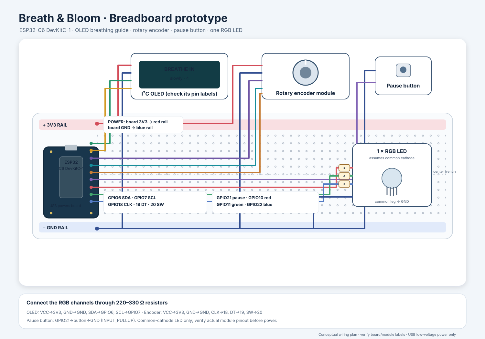

# Breath & Bloom: Build and Manasika Integration Manual

**Prototype:** ESP32-C6 guided breathing and grounding companion  
**For:** breadboard assembly, Arduino IDE firmware, BLE, and optional Manasika website integration  
**Revision:** 1.0 · 23 November 2026

> This is a low-voltage wellbeing prototype, not a medical or diagnostic device. It does not detect anxiety, infer a user's mental state, or replace professional support. Breathing is gentle and optional; the user can pause or stop at any time.

## 1. What you are building

Breath & Bloom is a USB-powered desk device. Its OLED shows a breathing phase or a 5–4–3–2–1 grounding prompt; the RGB LED slowly brightens and dims; the rotary encoder adjusts the breathing pace; and two switches let the user start/pause and switch practice modes. The ESP32-C6 advertises a small Bluetooth Low Energy (BLE) GATT service. The Manasika website can connect after the user selects **Connect device**, then show device state and send simple controls.

The board runs by itself if Bluetooth or the website is unavailable. BLE carries only current exercise state and button commands. This prototype does not send mood ratings, names, location, account identifiers, or history.

### Repository companion files

- [Breadboard diagram](BreathBloom-breadboard.svg)
- [Arduino IDE sketch](BreathBloom.ino)
- [Website BLE helper](breathBloomBle.ts)

The UI integration is described below; it is a manual integration step and is not already present in the current Manasika app.

## 2. Parts and assumptions

The kit photo lists an ESP32-C6, breadboard, OLED, rotary encoder, tactile switches, and RGB LEDs. This guide assumes:

- An **ESP32-C6-DevKitC-1** development board. Other C6 boards may label pins differently.
- A 128×64 SSD1306 OLED with I²C pins `VCC`, `GND`, `SDA`, `SCL`, commonly using address `0x3C`.
- An encoder module labelled `CLK`, `DT`, `SW`, `VCC`, and `GND`.
- One ordinary 4-pin **common-cathode** RGB LED, not an addressable WS2812/NeoPixel LED.
- Two breadboard pushbuttons. One is the encoder's built-in switch; one is the separate mode button.
- Three 220–330 Ω resistors, one in series with each LED color. If the kit does not include them, add them before wiring the RGB LED.

Check the actual board/module labels and datasheets before applying power. The documented DevKitC-1 provides 3.3 V and 5 V supply pins; its GPIO logic is 3.3 V. GPIO6 and GPIO7 are available for SDA/SCL, while GPIO18–22 are available as general-purpose pins on the documented board. This pin plan is specific to that board. [Espressif ESP32-C6-DevKitC-1 guide](https://docs.espressif.com/projects/esp-dev-kits/en/latest/esp32c6/esp32-c6-devkitc-1/user_guide.html)

### Pin assignment

| ESP32-C6 pin | Connect to | Purpose |
|---|---|---|
| 3V3 | Positive breadboard rail | Module power, only when the module supports 3.3 V |
| GND | Ground rail | Shared ground |
| GPIO6 | OLED SDA | I²C data |
| GPIO7 | OLED SCL | I²C clock |
| GPIO18 | Encoder CLK | Rotary movement A |
| GPIO19 | Encoder DT | Rotary movement B |
| GPIO20 | Encoder SW | Start/pause switch |
| GPIO21 | Separate pushbutton to GND | Switch between breathing and grounding |
| GPIO10 | Red LED leg through 220–330 Ω resistor | Red PWM channel |
| GPIO11 | Green LED leg through 220–330 Ω resistor | Green PWM channel |
| GPIO22 | Blue LED leg through 220–330 Ω resistor | Blue PWM channel |

The sketch uses `INPUT_PULLUP` for switches: each switch connects its GPIO to GND when pressed. Never connect a 5 V signal to an ESP32-C6 GPIO. Some ultrasonic modules have a 5 V echo output; that sensor is deliberately not used in this build.

## 3. Breadboard assembly



1. **Unplug USB.** Place the ESP32-C6 across the breadboard's center trench so its two header rows are not electrically shorted together.
2. Connect the board's `3V3` pin to the positive rail and a `GND` pin to the ground rail. Keep the positive and ground rails visually distinct.
3. Connect OLED `VCC` to 3V3, `GND` to ground, `SDA` to GPIO6, and `SCL` to GPIO7. Confirm whether the OLED board supports 3.3 V before connecting it. Its I²C pull-ups must not pull SDA/SCL up to 5 V.
4. Connect encoder `VCC` to 3V3 and `GND` to ground. Connect `CLK` to GPIO18, `DT` to GPIO19, and `SW` to GPIO20.
5. Place the separate mode button so its two contacts span the breadboard's center trench. Connect one side to GPIO21 and the other to ground. A 10 kΩ external pull-up is not required when the sketch's internal pull-up is enabled.
6. Identify the LED's common leg and color legs using the component datasheet. For **common cathode**, connect the common leg to ground. Connect each color leg to its own resistor, then to GPIO10 (red), GPIO11 (green), or GPIO22 (blue). Do not share one resistor between colors.
7. Check for rail breaks in the breadboard; bridge split rails if needed. Inspect for shorts between 3V3 and GND.
8. Connect USB only after checking polarity and continuity. The prototype is USB-powered; do not add mains wiring or a battery charger in this first version.

If your RGB LED is common-anode, its common leg goes to 3V3 and the sketch's LED output logic must be inverted. If it is a WS2812 module, do not use this 3-PWM wiring: that module requires a single data pin and its own module-specific power guidance.

## 4. Install and upload the Arduino firmware

The supplied [BreathBloom.ino](BreathBloom.ino) is the complete starting sketch. It targets Arduino-ESP32 **3.x** and NimBLE-Arduino **2.x**. Arduino Core 4.0 has a rewritten BLE API that Espressif currently documents as potentially unstable, so this example uses the separately maintained NimBLE-Arduino API instead. Pin your installed library/core versions for a reproducible build. [Arduino-ESP32 BLE API notes](https://docs.espressif.com/projects/arduino-esp32/en/latest/api/ble.html), [NimBLE-Arduino guide](https://github.com/h2zero/NimBLE-Arduino/blob/master/docs/New_user_guide.md)

### Arduino IDE setup

1. Install Arduino IDE 2.x.
2. In **File → Preferences → Additional boards manager URLs**, add Espressif's Arduino board index if it is not already configured: `https://espressif.github.io/arduino-esp32/package_esp32_index.json`.
3. Open **Tools → Board → Boards Manager**, install **esp32 by Espressif Systems** in the 3.x series, then select **ESP32C6 Dev Module** (or the exact matching C6 board package entry).
4. Open **Sketch → Include Library → Manage Libraries** and install **Adafruit SSD1306**, **Adafruit GFX Library**, and **NimBLE-Arduino** 2.x. Install any dependency prompted by Library Manager.
5. Open `BreathBloom.ino`. Select the detected ESP32-C6 board and its USB/serial port. If the selected module has a flash-size or USB-mode option, use the board vendor's setting.
6. Click **Verify** first. Resolve missing libraries or board-selection errors before continuing.
7. Click **Upload**. If upload waits for a connection, press and hold **BOOT**, tap **RESET**, then release **BOOT** when the IDE begins connecting.
8. Open **Tools → Serial Monitor**, set it to **115200 baud**, and look for `Breath & Bloom ready`.

The sketch expects OLED I²C address `0x3C` and uses ESP32 Arduino Core 3.x `ledcAttach`/`ledcWrite` calls for the LED fade. If the screen stays blank, run an I²C scanner and change `0x3C` to the detected address (often `0x3D`). If your exact C6 board differs, update `PIN_*` constants after checking its official pinout.

### Physical controls

- Turn the rotary encoder to set inhale pace from 3 to 8 seconds.
- Press the encoder shaft to start or pause.
- Press the separate button to switch between breathing and grounding prompts.
- In breathing mode the sketch uses a gentle inhale/exhale pattern with no breath-hold phase. The displayed guidance explicitly says there is no need to hold the breath.
- In grounding mode it cycles the five sensory prompts. The user can pause or stop at any time.

## 5. BLE protocol

The ESP32 is the **BLE peripheral/GATT server**; the website browser is the **central/GATT client**. This is Bluetooth Low Energy, not Bluetooth Classic serial (ESP32-C6 does not provide the Classic `BluetoothSerial` approach). The sketch advertises `Manasika-BreathBloom` and the service below.

| GATT element | UUID | Properties | Use |
|---|---|---|---|
| Service | `7a4e0001-7c7f-4f2e-9d8d-8e1e2c4b0100` | — | Device controls and status |
| State characteristic | `7a4e0002-7c7f-4f2e-9d8d-8e1e2c4b0100` | Read, Notify | Current mode, phase, pace, remaining seconds |
| Command characteristic | `7a4e0003-7c7f-4f2e-9d8d-8e1e2c4b0100` | Write | Small allowed commands from site |

Commands are UTF-8, with no JSON wrapper: `start`, `pause`, `stop`, `mode:breath`, or `mode:grounding`. The state characteristic notifies compact JSON such as:

```json
{"v":1,"event":"phase","mode":"breath","phase":"inhale","remaining":4,"pace":4}
```

The browser must request the BLE device after a user gesture (a click), on an HTTPS page. Web Bluetooth has limited browser support and is unavailable in some widely used browsers; treat the physical controls as the fallback. For a browser BLE application, test the exact target browsers and devices. [MDN Web Bluetooth API](https://developer.mozilla.org/en-US/docs/Web/API/Web_Bluetooth_API), [MDN `requestDevice()`](https://developer.mozilla.org/en-US/docs/Web/API/Bluetooth/requestDevice)

## 6. Add BLE controls to Manasika

Current Manasika sections already include **Peace Corner** with Guided breathing and 5–4–3–2–1 grounding, and **Mood Journey** with user-selected check-ins. Add the BLE connection as a small device-control card **inside Peace Corner**, beside the existing practice—not as a replacement for its tabs or mood protocols. The existing Mood Journey remains the place where the user chooses and saves a mood. The device does not measure mood, so do not convert an exercise phase into a mood rating.

The current app is a React + TypeScript/Vite site. Its `MoodJourney` check-ins and activity currently use browser `localStorage`; the backend's creative API does not need to be involved in this BLE path. The browser connects directly to the nearby device. Do not send BLE data to Render or add it to the creative training database by default.

### Add the helper module

Copy [breathBloomBle.ts](breathBloomBle.ts) to `shivUIdes/manasika-ui/src/breathBloomBle.ts`. It requests the device, subscribes to state notifications, exposes a command method, and returns a disconnect function. It sends only the five allowlisted command strings.

### Add a small device card to Peace Corner

In `src/App.tsx`, import the helper and its state type:

```tsx
import { connectBreathBloom, type BreathBloomState } from "./breathBloomBle";
```

Add this component in the same file, near `Peace()`. It uses existing `Button`, `Kicker`, and `useState` components/hooks:

```tsx
function BreathBloomCard() {
  const [link, setLink] = useState<Awaited<ReturnType<typeof connectBreathBloom>> | null>(null);
  const [state, setState] = useState<BreathBloomState | null>(null);
  const [message, setMessage] = useState("Not connected");

  useEffect(() => () => link?.disconnect(), [link]);

  const connect = async () => {
    setMessage("Choose your Breath & Bloom device in the browser prompt.");
    try {
      const session = await connectBreathBloom(setState);
      session.device.addEventListener("gattserverdisconnected", () => {
        setLink(null);
        setMessage("Device disconnected. You can continue with the on-screen practice.");
      }, { once: true });
      setLink(session);
      setMessage("Connected nearby. Device state stays in this browser session.");
    } catch (error) {
      setMessage(error instanceof Error ? error.message : "Could not connect to the device.");
    }
  };

  const send = (command: "start" | "pause" | "stop" | "mode:breath" | "mode:grounding") => {
    void link?.send(command).catch(() => setMessage("Command failed. Check the BLE connection."));
  };

  return (
    <section className="practice-stage" aria-label="Breath & Bloom device">
      <div className="practice-copy">
        <Kicker>OPTIONAL PHYSICAL COMPANION</Kicker>
        <h2>Breath &amp; Bloom</h2>
        <p>{state ? `${state.mode} · ${state.phase} · ${state.remaining}s` : message}</p>
        {!link ? <Button onClick={() => void connect()}>Connect device</Button> : <>
          <Button onClick={() => send("start")}>Start</Button>
          <Button variant="secondary" onClick={() => send("pause")}>Pause</Button>
          <Button variant="ghost" onClick={() => { link.disconnect(); setLink(null); setMessage("Disconnected"); }}>Disconnect</Button>
        </>}
      </div>
    </section>
  );
}
```

Render `<BreathBloomCard />` inside the existing Peace Corner page, preferably below `PageHeader` and above the existing practice area. Keep the current Peace tabs and practice state intact. If adding the card creates duplicated start/pause controls, present it as a hardware mirror: clarify that the encoder/button can control the device locally and the new buttons send the same simple commands.

### Browser and hosting requirements

- The current public Manasika site uses HTTPS, which is required by Web Bluetooth. Local development on `http://localhost` is treated as a secure context by supporting browsers; a LAN IP over plain HTTP generally is not.
- Call `connectBreathBloom()` directly from the **Connect device** click. Do not call it automatically in `useEffect` or on page load; the device chooser requires a user gesture.
- Web Bluetooth is not supported by every browser. Provide a friendly unsupported-browser message and keep Peace Corner's existing on-screen breathing/grounding controls usable.
- If the page is embedded in an iframe, check its Permissions Policy for `bluetooth`; the deployment should not deny the feature.
- On Android, try a current Chrome browser with Bluetooth enabled. Desktop Chromium browsers may support the API. iOS/Safari and other unsupported environments should use the existing on-screen controls or a separately built native companion; do not promise universal browser BLE support.

## 7. Test and acceptance checklist

### Hardware-only

- [ ] USB powers the C6 without warm components, resets, or a 3V3-to-GND short.
- [ ] OLED displays the title and idle prompt.
- [ ] Encoder rotation changes pace between 3 and 8 seconds.
- [ ] Encoder press starts and pauses the practice.
- [ ] Separate button switches the OLED to/from grounding prompts.
- [ ] RGB LED fades gently and turns off when paused.

### BLE and website

- [ ] A BLE scanner sees `Manasika-BreathBloom` and the documented service UUID.
- [ ] In a supported HTTPS browser, the **Connect device** click opens the browser's chooser and can connect.
- [ ] State notifications update the card during inhale/exhale and grounding.
- [ ] Website Start/Pause commands affect the device; physical switches still work.
- [ ] Disconnecting restores the regular Peace Corner controls and does not crash the page.
- [ ] No mood entry is created from BLE exercise state. Mood entries are saved only after the user selects/saves one in Mood Journey.
- [ ] Unsupported browser, permission denial, or powered-off device produces a helpful message; on-screen practices still work.

## 8. Troubleshooting

| Symptom | Check |
|---|---|
| OLED blank | OLED is 3.3 V-compatible; SDA/SCL are not reversed; scan for address `0x3C`/`0x3D`; check shared ground. |
| Board resets or gets hot | Unplug USB immediately. Inspect power-rail polarity, shorts, and any module accidentally powered at 5 V. |
| LED is dark or colors wrong | Check common-cathode vs common-anode wiring, each resistor, and which pin is each color. Invert logic for common-anode. |
| Encoder moves the wrong direction | Swap GPIO18/19 or invert the direction expression in `pollEncoder()`. |
| Encoder button bounces | Confirm switch leg orientation and GND path; increase the debounce interval. |
| Sketch won't compile | Select ESP32-C6, Arduino-ESP32 3.x, NimBLE-Arduino 2.x, Adafruit SSD1306, and Adafruit GFX. Avoid mixing NimBLE 1.x and 2.x APIs. |
| Device not listed by browser | Confirm advertising/serial output, Bluetooth is enabled, browser supports Web Bluetooth, and service UUID matches. Disconnect from any BLE scanner first. |
| Browser says unsupported or permission denied | Open the deployed HTTPS page in a compatible browser, trigger connection by clicking, and check Bluetooth permission/policy. Continue with the on-screen controls if unsupported. |
| Connects but controls do nothing | Verify command UUID/property is WRITE, state UUID is NOTIFY, and the firmware and `breathBloomBle.ts` UUID strings match exactly. |

## 9. Privacy, comfort, and scope

- BLE is local nearby communication; the BLE feature itself does not need Wi-Fi, GPS, a cloud API key, or a Render backend endpoint.
- This first firmware does not persist exercise logs and does not transmit mood data. If mood check-in hardware is added later, require explicit user action and consent before writing to Mood Journey.
- Do not add raw behavior analysis, automatic mood inference, or cross-user sharing to this device. Use the app's existing optional/private boundaries.
- Use slow, non-flashing light. Keep the display readable and offer immediate pause/stop. Users can skip breathing and select grounding instead.
- Keep an accessible on-screen version of both practices for users without a compatible BLE browser or device.

## 10. Sources and version notes

- [Espressif ESP32-C6-DevKitC-1 pinout and power guide](https://docs.espressif.com/projects/esp-dev-kits/en/latest/esp32c6/esp32-c6-devkitc-1/user_guide.html)
- [Espressif Arduino-ESP32 BLE API](https://docs.espressif.com/projects/arduino-esp32/en/latest/api/ble.html)
- [NimBLE-Arduino new user guide](https://github.com/h2zero/NimBLE-Arduino/blob/master/docs/New_user_guide.md)
- [NimBLE-Arduino 1.x to 2.x migration notes](https://github.com/h2zero/NimBLE-Arduino/blob/master/docs/1.x_to_2.x_migration_guide.md)
- [MDN Web Bluetooth API and browser support caveat](https://developer.mozilla.org/en-US/docs/Web/API/Web_Bluetooth_API)
- [MDN Web Bluetooth requestDevice and secure-context requirements](https://developer.mozilla.org/en-US/docs/Web/API/Bluetooth/requestDevice)

Verify the stated pins and BLE UUIDs against your exact hardware before use.
